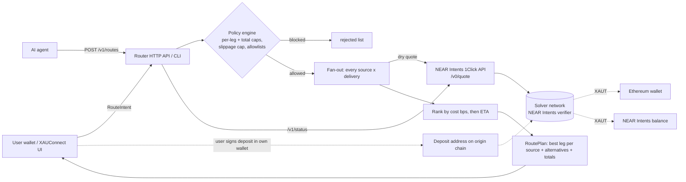

# XAUConnect Gold Router on NEAR Intents

**What it is:** a multi-chain router that turns stablecoins spread across many chains into tokenized gold (XAUT) in one plan, using NEAR Intents (1Click Swap API) for cross-chain settlement. It exposes a CLI, an HTTP API for wallets and AI agents, and a small web page. It is built as a NEAR Intents routing layer for [XAUConnect](https://xauconnect.com), a non-custodial multi-chain DEX aggregator.

**Problem:** a user (or an agent managing a treasury) holds USDC on Arbitrum, USDT on Ethereum, USDC on Base, and wants gold. Today that means a bridge per chain, a DEX per chain, gas tokens everywhere, and no single view of total cost. 

**Product:** you describe the outcome once ("these balances -> XAUT, delivered to this wallet or kept in my NEAR Intents account"). The router asks NEAR Intents solvers for a quote for every (source, delivery) pair in parallel, applies a spending policy, ranks by total cost (fees + price impact, in basis points), and returns one best leg per source plus every alternative it considered.

**How NEAR fits in:** every leg settles through NEAR Intents. The router uses 1Click `/v0/tokens` for the live asset registry, `/v0/quote` (dry run) for signed solver quotes, and `/v0/status` for tracking. It can deliver either on the destination chain or into a NEAR Intents balance (`recipientType: INTENTS`), which live quotes show is cheaper (example below).

Tracks: `defi`, `realworld`, `agents` (see [docs/TRACKS.md](docs/TRACKS.md)).

## Try it (judges: do X -> see Y)

Requires Node.js >= 23.6 (runs TypeScript directly, no install, no dependencies).

1. Offline, no network:
   ```sh
   npm test          # -> 11 passing tests
   npm run demo      # -> MOCK MODE plan: 2 legs into XAUT, INTENTS delivery picked as cheaper
   ```
2. Live NEAR Intents quotes (dry run, nothing is signed or sent). Use any public address you own:
   ```sh
   A=0xYourEvmAddress
   node src/cli.ts tokens XAUT
   # -> XAUT  eth  $<price>  nep141:eth-0x68749665ff8d2d112fa859aa293f07a622782f38.omft.near
   node src/cli.ts plan --from 100:USDC:arb:$A --from 60:USDT:eth:$A --from 25:USDC:base:$A --to XAUT:eth:DESTINATION_CHAIN:$A
   # -> one leg per source, cost in bps and ETA per leg, and a total
   node src/cli.ts plan --from 100:USDC:arb:$A --to XAUT:eth:INTENTS:your-account.near --to XAUT:eth:DESTINATION_CHAIN:$A
   # -> picks INTENTS delivery; shows DESTINATION_CHAIN as the costlier alternative
   ```
3. HTTP API + web page:
   ```sh
   npm start                       # or MOCK=1 npm start
   open http://localhost:8787/     # edit the JSON intent, click "Plan route"
   curl -X POST localhost:8787/v1/routes -d @examples/intent.json
   ```
4. Policy guardrails: `POLICY_MAX_USD_PER_LEG=50 node src/cli.ts plan --from 100:USDC:arb:$A --to XAUT:eth:DESTINATION_CHAIN:$A` -> `BLOCKED by policy`, and no quote is requested.

Example live output (28 Oct 2026, dry run):
```
100 USDC@arb -> 0.024663 XAUT@eth [INTENTS]  in $99.94 out $99.65  cost 29 bps  ~27s
  alternatives considered:
    USDC@arb -> XAUT@eth [DESTINATION_CHAIN] cost 53 bps
```

## Architecture



Dotted lines are the execution path, which this repo does not perform: the user's own wallet signs and sends the deposit. The router never holds keys or funds.

### Code map
| Path | What |
| --- | --- |
| `src/oneclick.ts` | 1Click API client (tokens, quote, status), optional JWT |
| `src/registry.ts` | Symbol + chain -> 1Click `assetId` from the live token list |
| `src/policy.ts` | Spending guardrails, configurable via env |
| `src/router.ts` | Fan-out, ranking, plan assembly |
| `src/mock.ts` | Offline deterministic quote simulator for tests and demos |
| `src/cli.ts`, `src/server.ts`, `web/index.html` | Interfaces |
| `test/` | `node:test` unit tests |

## Setup
```sh
cp .env.example .env   # fill in public addresses only; never a private key
npm test
npm start
```

## What is real vs simulated
| Piece | Status |
| --- | --- |
| Token registry, dry-run quotes, status lookups | Real, live 1Click API |
| Policy engine, ranking, multi-source planning | Real |
| `MOCK=1` quotes | Simulated fees (25/60 bps), for offline tests only |
| Execution (sending deposits) | Not implemented by design; user's wallet signs. Planned: wallet-side deposit via XAUConnect UI |
| XAUConnect same-chain aggregator comparison | Planned adapter (`/api/swap/quote`), not yet wired |

## Hackathon provenance
Built for NEAR HACKATHON (1-14 Nov 2026). XAUConnect itself (the existing DEX aggregator at xauconnect.com) predates the hackathon; this repository is new code. See `docs/PROVENANCE.md` for what was written when.

## Safety
- Dry-run quotes only; no signing, no private keys, no funds moved.
- Secrets (JWT) only via environment variables; `.env` is git-ignored.
- Not financial advice. Tokenized gold (XAUT) carries issuer, bridge and smart-contract risk.

## License
MIT
