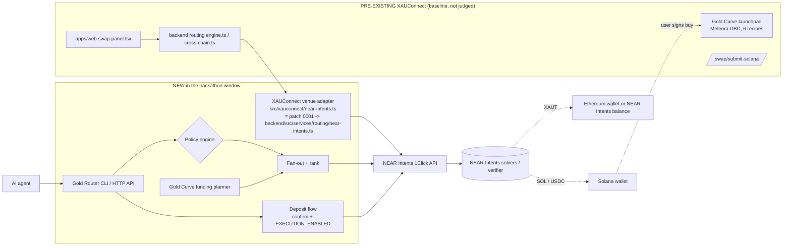

# XAUConnect Gold Router

| | |
| --- | --- |
| Project | XAUConnect Gold Router: NEAR Intents settlement for [XAUConnect](https://xauconnect.com) |
| Owner | Akhilesh Patil, [@akhilexx](https://github.com/akhilexx), owner of XAUConnect ([github.com/akhilexx/xauconnect](https://github.com/akhilexx/xauconnect)) |
| Event | NEAR HACKATHON, 19 Oct-14 Nov 2026 (code window per HACKATHON.md Q-001) |
| Tracks | `defi`, `realworld`, `agents` |
| Prize account (NEAR mainnet, implicit) | `d10d7e27627fa755058f776b9632ad29bd407a423db15406ecde02a47cd60c3e` |
| License | MIT |

**What it is:** a cross-chain routing and settlement layer, built on NEAR Intents (1Click Swap API), for XAUConnect. It does two jobs:
1. **Gold from any chain:** stablecoins on Arbitrum, Ethereum, Base, Solana and other chains become tokenized gold (XAUT) in one plan.
2. **Fund a Gold Curve buy from any chain:** USDC or USDT on an EVM chain becomes SOL or USDC in the buyer's Solana wallet. That is the quote token an XAUConnect Gold Curve pool needs. The buyer then buys on the existing XAUConnect token page.

It ships as a dependency-free CLI, an HTTP API for wallets and AI agents (with hard spending limits), and a demo page. Two more pieces come with it:
- a **wallet-signed deposit flow**. It is off by default. When enabled, it returns unsigned deposit transactions for the user's own wallet to sign.
- **ready-to-apply patches for the XAUConnect repo** (`patches/xauconnect/`). They add a NEAR Intents venue, the deposit helpers and a "Fund from another chain" panel. The patches have not been applied to XAUConnect yet. See [What is new vs pre-existing](#what-is-new-vs-pre-existing).

**Problem:** XAUConnect quotes and swaps on 7 chains, but moving value *between* chains goes through EVM-only bridge routes. A Solana Gold Curve buyer who holds USDC on Base has to bridge by hand first.

**How NEAR fits in:** every cross-chain leg settles through NEAR Intents. The router uses `/v0/tokens` for the live asset registry, `/v0/quote` for signed solver quotes (dry run by default), and `/v0/status` for tracking. It can also deliver into a NEAR Intents balance (`recipientType: INTENTS`), which live quotes show costs less than withdrawing to a chain.

## Try it (judges: do X -> see Y)
Requires Node.js >= 23.6, which runs TypeScript directly. There is no install step and there are no dependencies.

1. Offline, no network:
   ```sh
   npm test        # -> 53 pass, 0 fail, 7 todo (todo = backlog items 4-5, not built)
   npm run demo    # -> MOCK MODE plan: 2 legs into XAUT, INTENTS delivery picked as cheaper
   ```
2. Live NEAR Intents quotes (dry run; nothing is signed or sent). Use any public addresses you own:
   ```sh
   A=0xYourEvmAddress; S=YourSolanaAddress; N=your-account.near
   node src/cli.ts tokens XAUT
   # -> XAUT  eth  $<price>  nep141:eth-0x68749665ff8d2d112fa859aa293f07a622782f38.omft.near
   node src/cli.ts plan --from 100:USDC:arb:$A --from 60:USDT:eth:$A --from 25:USDC:base:$A --to XAUT:eth:DESTINATION_CHAIN:$A
   # -> one leg per source chain, cost in bps and ETA per leg, and a total
   node src/cli.ts plan --from 100:USDC:arb:$A --to XAUT:eth:INTENTS:$N --to XAUT:eth:DESTINATION_CHAIN:$A
   # -> picks INTENTS delivery; DESTINATION_CHAIN listed as the costlier alternative
   node src/cli.ts goldcurve --mint HXXMuNxDShXhK6QGd4CczTgSiXr1YqNbUdpg9rTbWj5r --recipe fair-sol --wallet $S --from 40:USDC:arb:$A --from 30:USDC:base:$A
   # -> SOL delivered to the Solana wallet for the live XAUGC Fair/SOL pool, plus the XAUConnect token page link to finish the buy
   node src/cli.ts fund --mint HXXMuNxDShXhK6QGd4CczTgSiXr1YqNbUdpg9rTbWj5r --pool-config ExTrSGZBjzMrueBNHEALCCJmppB9zpoTSWJea4iR2gQu \
     --wallet $S --from-chain arbitrum --token-in 0xaf88d065e77c8cc2239327c5edb3a432268e5831 --sender $A --want 0.5 --raised 9.8
   # -> "Fund from another chain" through the same venue code that ships to XAUConnect: exact-output quote for 0.5 SOL,
   #    graduation warning (only 0.2 SOL left), hand-off link. See docs/live-dry-quotes.md for a recorded run.
   ```
3. HTTP API and demo page: `npm start` (or `MOCK=1 npm start`), open `http://localhost:8787/`, edit the intent, click **Plan route**. Or run `curl -X POST localhost:8787/v1/routes -d @examples/intent.json`.
4. Deposit flow gates: run `POST /v1/routes`, then `POST /v1/routes/<intentId>/execute {"leg":0}`. You get **403 CONFIRM_REQUIRED**. With `"confirm":true` you get **403 EXECUTION_DISABLED** unless the server runs with `EXECUTION_ENABLED=1`. `MOCK=1 EXECUTION_ENABLED=1 npm start` shows the unsigned output (ERC-20 `transfer` calldata to a fake `0x…dEaD` deposit address) without touching the network.
5. Policy guardrails: `POLICY_MAX_USD_PER_LEG=50 node src/cli.ts plan --from 100:USDC:arb:$A --to XAUT:eth:DESTINATION_CHAIN:$A` -> `BLOCKED by policy`, and no quote is requested.

Example live output (28 Oct 2026, dry run):
```
100 USDC@arb -> 0.024648 XAUT@eth [INTENTS]  in $99.94 out $99.68  cost 25 bps  ~27s
  alternatives considered:
    USDC@arb -> XAUT@eth [DESTINATION_CHAIN] cost 50 bps
40 USDC@arb -> 0.395210543 SOL@sol [DESTINATION_CHAIN]  in $39.97 out $39.89  cost 21 bps  ~22s
```

## Architecture

Dotted lines are settlement and the user's own signing. The router never holds keys or funds. The `WEB --> ENG --> ADP` path exists only once the patches are applied to XAUConnect.

### Code map (this repo)
| Path | What |
| --- | --- |
| `src/oneclick.ts` | 1Click API client (tokens, quote, status), optional JWT |
| `src/registry.ts` | Symbol + chain -> 1Click `assetId` from the live token list |
| `src/policy.ts` | Spending guardrails, configurable via env |
| `src/router.ts` | Fan-out, ranking, plan assembly |
| `src/goldcurve.ts` | Gold Curve funding intents for the router (recipes come from `src/xauconnect/fund-curve.ts`) |
| `src/execute.ts` | Deposit flow: confirm + `EXECUTION_ENABLED=1` gates, policy re-check, 60s re-quote, slippage abort, one `dry:false` per leg, unsigned EVM/Solana instructions |
| `src/xauconnect/near-intents.ts` | NEAR Intents venue for XAUConnect (shipped unchanged as patch 0001): 7-chain key map, token resolution, dry quotes as "XAU Route", gated build, status, user errors, Express-agnostic handlers |
| `src/xauconnect/fund-curve.ts` | "Fund from another chain": pool config -> recipe -> quote token, exact-output body, graduation warning |
| `src/xauconnect/solana-deposit-ix.ts`, `src/xauconnect/status.ts` | Byte-exact Solana transfer data; status poller and timeline copy |
| `patches/xauconnect/` | `git am` patches (new files) + `INTEGRATION.md` hand edits for existing XAUConnect files |
| `src/mock.ts` | Offline deterministic quote simulator for tests |
| `src/cli.ts`, `src/server.ts`, `web/index.html` | Interfaces |
| `test/` | `node:test` tests (53). `test/backlog.test.ts` holds 7 todo stubs for backlog items 4-5 |

## What is new vs pre-existing
**Pre-existing XAUConnect (baseline, before 19 Oct 2026; not submitted for judging):** the public repo [akhilexx/xauconnect](https://github.com/akhilexx/xauconnect) (Turborepo: `apps/web` Next.js 15, `apps/mobile` Expo, `backend` Express API, Prisma/PostgreSQL, `packages/contracts|sdk|ui|utils`). That baseline includes:
- multi-chain swap quotes, builds, liquidity and the wallet view on Ethereum, BNB Chain, Polygon, Arbitrum, Base, Avalanche and Solana;
- EVM-origin cross-chain routes (`backend/src/services/routing/cross-chain.ts`);
- the Solana broadcast relay (`/swap/submit-solana`);
- the on-chain market indexer;
- the Gold Curve launchpad: Meteora DBC, six recipes, and the live XAUGC pool.

**New (hackathon window):**
- this repository, all of it, with its real git history starting 28 Oct 2026: the router, policy engine, Gold Curve funding planner, deposit flow, XAUConnect venue adapter, Fund-from-another-chain module, CLI, API, demo page, and the XAUConnect patches. HACKATHON.md Q-001: "Code before 2026-11-01? Yes, from the announcement on 2026-10-19 ... Earlier commits are baseline." No commit in this repository predates 28 Oct 2026, and none of its code is copied from XAUConnect.
- a branch `near-intents-hackathon` on akhilexx/xauconnect, planned but **not created yet**. It is to be tagged `pre-hackathon` at its base and `hackathon-submission` at the end (per Q-003).
  - Its new files are the patches in `patches/xauconnect/` (0001-0004).
  - Its edits to existing files are described in `patches/xauconnect/INTEGRATION.md`. They were written without access to the XAUConnect source, so they need adapting.
  - Diff link: *(added when the branch exists)*.

Full log: [docs/PROVENANCE.md](docs/PROVENANCE.md). Plan of record: [docs/BACKLOG.md](docs/BACKLOG.md). Track rationale: [docs/TRACKS.md](docs/TRACKS.md).

## XAUConnect today (self-reported)
These are the owner's figures, read from the XAUConnect production database on 28 Oct 2026 (aggregates only). XAUConnect is early stage: it is shipped and live, the indexer runs at scale, and usage is tiny.
- Registered users 12 (first 15 Jun 2026); active 24h 0, 7d 2, 30d 5; connected wallets 7.
- Swaps 11 total (2 in the last 30 days), all-time volume about $10.34, protocol fees about $0.28. By chain: Solana 3 swaps ($7.14), Polygon 4 ($3.20), Base 2, Ethereum 2.
- Gold Curve launches on mainnet: 1 (XAUGC).
- Indexer: 49,261 pools tracked; 1,174 API requests logged.

## What is real vs simulated
| Piece | Status |
| --- | --- |
| Token registry, dry-run quotes, status lookups | Real, live 1Click API (mainnet; NEAR Intents has no testnet, Q-007) |
| Policy engine, ranking, multi-source planning, Gold Curve funding plan | Real |
| `MOCK=1` quotes | Simulated fees, offline tests only |
| Deposit flow (unsigned instructions) | Built and tested against stubs and mock. Off by default. No deposit address has ever been requested (`dry:false` never sent) and no funds moved. 1Click has no testnet, so the first real deposit has to be a small one the owner runs by hand |
| Wallet signing | Not in this repo. In XAUConnect the user's own wallet signs (`deposit.ts` in patch 0002); type-checked and smoke-built, not run with a wallet |
| XAUConnect venue adapter | Built and tested here (same bytes as patch 0001); not yet applied to XAUConnect |
| XAUConnect UI (status timeline, Fund-from-another-chain panel) | Written and type-checked (React 19 types); not run in the app |
| Edits to existing XAUConnect files | Anchored snippets only (`INTEGRATION.md`), unverified against real code |

## Setup
```sh
cp .env.example .env   # public addresses only; never a private key or seed phrase
npm test && npm start
```

## Safety
- Dry-run quotes by default. No private keys, nothing signed by this code.
- Secrets (JWT) only via environment variables; `.env` is git-ignored.
- Not financial advice. XAUT and bonding-curve tokens carry issuer, bridge and smart-contract risk.

## License
MIT. See LICENSE.
